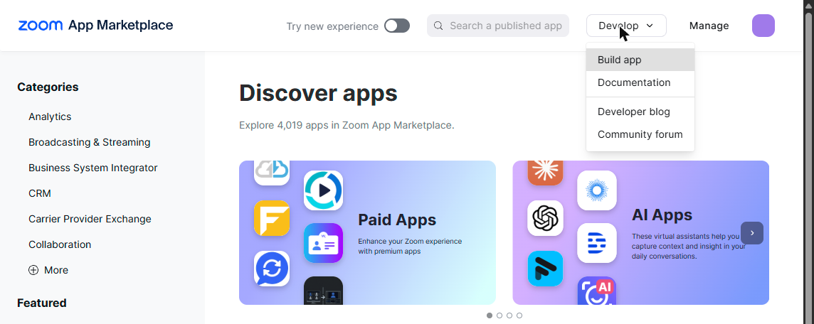
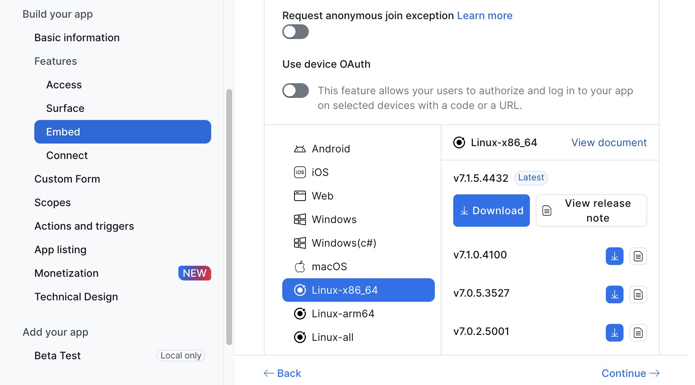

<!-- Generated by ./bwat docs from docs/onboarding/master.md and docs/onboarding/templates/guide.md; edit those, then run ./bwat docs. -->
# bwat onboarding

What bwat is, and the one line that installs it with Claude Code: [the README](https://github.com/qoralai/bwat#start-here).

One person installs bwat. On a cloud server that person needs Google admin and Zoom admin access; everyone else signs in and installs the plugin. Where the two ways differ, a step shows them side by side.

- [Choose where bwat runs](#choose-where-bwat-runs)
- [For the installer](#for-the-installer)
- [For everyone else](#for-everyone-else)
- [Your first meeting](#your-first-meeting)
- [If something doesn't work](#if-something-doesnt-work)

## Choose where bwat runs

| | local: try it on this computer | production: on a cloud server |
|---|---|---|
| Where | Your own computer. | AWS or any cloud server. |
| Address | `http://localhost:8080`; only you use it. | A public domain; HTTPS from bwat itself (ports 80 and 443) or the cloud's load balancer. |
| Sign-in | A code setup shows you, and your email. No Google. | Google, from your company's domains. |
| Board inside Zoom | No: the board shows in your browser. | Yes. |
| Joining meetings | Paste a meeting link; bwat joins it. | Also joins on its own: Zoom meeting events and auto-join. |

Only production gets Zoom's meeting events, because Zoom cannot reach a private address. The setup page installs local only.

## For the installer

### The easy way: let Claude Code install it

Open Claude Code in any folder and paste [the line in the README](https://github.com/qoralai/bwat#start-here) ([what it follows](https://github.com/qoralai/bwat/blob/main/docs/setup-with-claude.md)). Claude explains each step, and you type every secret into bwat's setup page.

<details>
<summary>Or by yourself</summary>

In the bwat folder ([Download bwat](#download-bwat) first, and check [Before you start](#before-you-start)), run:

```sh
./bwat setup --web
```

It opens a page that walks you through each step and keeps your progress. Open the link it prints if no browser opens. Your progress survives a restart: run the same command again to carry on.

Prefer the terminal alone? Follow this guide's steps as written.

</details>

### Before you start

You'll need:

- Admin on your company's Zoom account.
- An [OpenRouter](https://openrouter.ai/) account with a few dollars of credit.
- Claude Code, with Node 22 or later, to receive cards.

<table>
<tr><th>Local</th><th>Production</th></tr>
<tr>
<td valign="top">

- Docker Desktop on macOS or Windows, or Docker Engine with Compose on Linux.

</td>
<td valign="top">

- Permission to create a Google Cloud project in your company's organisation, and a billing account for it.
- Google Workspace for your company's accounts.
- A domain whose DNS you can change, and hosting for bwat. For the single-server installer: a server with git, Docker Engine and Compose 2.1 or later, and ports 80 and 443 open or a proxy in front. For ECS or other cloud services, follow [Hosting bwat](hosting.md).

</td>
</tr>
</table>

<details>
<summary>Why each one</summary>

- The OpenRouter key pays for transcription and the card writer.

<table>
<tr><th>Local</th><th>Production</th></tr>
<tr>
<td valign="top">

- No Google: on this computer you sign in with a code setup shows you.

</td>
<td valign="top">

- A new project in a company organisation needs a billing account.
- bwat lets in only accounts from your company's Google domains, never personal Gmail.
- Each teammate needs a company Google account in one of the allowed domains.

</td>
</tr>
</table>

</details>

### Check this computer

Use one machine that stays on, with Docker and git.

**On macOS:**

Install [Docker Desktop for Mac](https://docs.docker.com/desktop/setup/install/mac-install/) and start it. For git, run `git --version` in Terminal: if macOS offers the command line developer tools, install them.

**On Windows:**

Install [Docker Desktop for Windows](https://docs.docker.com/desktop/setup/install/windows-install/) and start it, and [Git for Windows](https://git-scm.com/download/win), which brings Git Bash. Run bwat's commands in Git Bash or WSL.

**On WSL:**

Install Docker Desktop for Windows with its WSL integration on for your distribution, and git inside WSL. Run bwat's commands in WSL.

<details>
<summary>If Windows cannot open the setup page</summary>

`./bwat setup --web` prints a link that opens in your Windows browser. If Windows cannot reach it, set `localhostForwarding=true` under `[wsl2]` in `%UserProfile%\.wslconfig`, run `wsl --shutdown` in Windows, and start again.

</details>

**On Linux:**

Install [Docker Engine](https://docs.docker.com/engine/install/) with its Compose plugin, add yourself to the `docker` group, and install git from your package manager.

<details>
<summary>More detail</summary>

Any bash works: Terminal on Linux or macOS, or WSL or Git Bash on Windows. Allow about 2 CPUs, 4 GB memory and 20 GB disk.

</details>

### Download bwat

Clone the repository and open the bwat folder. Every command in this guide runs from it.

```sh
git clone https://github.com/qoralai/bwat.git && cd bwat
```

### Create the answers file

Create `bwat.answers`, the file that holds your setup answers.

```sh
./bwat prep
```

For Production on a cloud server:

Set `BWAT_MODE=production` in `bwat.answers`: `./bwat prep` writes `developer`, which installs on this computer only.

> **Never paste a secret into chat.** 🔒 marks a secret: type it into its field, or in a terminal run `./bwat secret KEY`. Check that the last four characters match the vendor's page. `bwat.answers` holds your secrets in plain text until you delete it at the end.

<details>
<summary>More detail</summary>

Setup reads `bwat.answers`, so it asks only for what is missing. On the setup page, each step's fields write to it. In the terminal alone, open it in your editor: each value has a comment saying what it is and where it is found, in the order you create them.

Zoom's Client IDs and the Server-to-Server Account ID are not secrets.

</details>

### Choose your address

For Production on a cloud server:

The address comes first because the Google and Zoom steps next ask for it: `https://` and a lowercase host name you own, pointed at the server, with no port, path or slash at the end, such as `https://bwat.company.com`.

#### Name the owner

For: Try it on this computer (local).

On this computer bwat has no Google: you sign in with your email and a code setup shows you.

| Field | Value |
|---|---|
| `BWAT_FIRST_OWNER_EMAIL` | Your email. You become bwat's first owner and the Zoom app's contact. |

#### Point a domain at the server

For: Production on a cloud server.

Point your domain at the server and open ports 80 and 443, or put a load balancer or proxy in front.

| Field | Value |
|---|---|
| `BWAT_PUBLIC_URL` | Your domain, such as `https://bwat.company.com`. |
| `BWAT_TLS` | `caddy` when bwat gives your domain its own HTTPS (ports 80 and 443 open); `external` behind a load balancer or proxy. |

The Google web client, next, needs two values made from your domain: the JavaScript origin `<address>` and the redirect URI `<address>/auth/callback`.

<details>
<summary>More detail</summary>

With ports 80 and 443 open, setup gets and renews the HTTPS certificate. A proxy on the same server forwards to `127.0.0.1` at the `BWAT_EDGE_PORT` in `bwat.answers` (the first free port from 8080); that port answers on the server only, so for a load balancer elsewhere, follow [Hosting bwat](hosting.md).

</details>

### Set up Google sign-in

<table>
<tr><th>Local</th><th>Production</th></tr>
<tr>
<td valign="top">

On this computer there is no Google sign-in: skip to Zoom.

</td>
<td valign="top">

Below, `<address>` means your full bwat address; the setup page shows your own.

</td>
</tr>
</table>

#### Create the Google web client

For: Production on a cloud server.

1. In [Google Cloud](https://console.cloud.google.com/), select your company's project, or create one.
2. Set up its sign-in screen as **Internal**: https://console.cloud.google.com/auth/overview > Get started: App Information, Audience Internal, Contact Information, Finish.

3. Create the web client: https://console.cloud.google.com/auth/clients > Create client, then Application type > Web application. Leave **This client will be used by an AI-powered agent** unticked.

   | Setting | Value |
   |---|---|
   | Authorized JavaScript origins | `<address>` |
   | Authorized redirect URIs | `<address>/auth/callback` |

4. Select **Create**, then the dialog that confirms the client > Download JSON: Google shows the secret only once. Copy the ID and secret below, then delete the file.

<details>
<summary>If Get started does not show</summary>

A project that already has a consent screen does not show **Get started** again, and Google cannot reset it: set Internal at Google Auth Platform > Audience (https://console.cloud.google.com/auth/audience) instead, or use a new project to see the first-time screens. **Internal** keeps sign-in to your Google organisation.

</details>

| Field | Value |
|---|---|
| `BWAT_ALLOWED_DOMAINS` | Your company's Google domains, such as `company.com`, separated by commas. |
| `BWAT_GOOGLE_CLIENT_ID` | In the downloaded file, `web` → `client_id`. |
| 🔒 `BWAT_GOOGLE_CLIENT_SECRET` | In the downloaded file, `web` → `client_secret`. |

_Click paths as of October 2026._

#### Create the Google desktop client

For: Production on a cloud server.

1. In the same project, https://console.cloud.google.com/auth/clients > Create client, then Application type > Desktop app, named **bwat desktop**.
2. Select **Create**, then the dialog that confirms the client > Download JSON. Copy the ID and secret below, then delete the file.

| Field | Value |
|---|---|
| `BWAT_GOOGLE_DESKTOP_CLIENT_ID` | In the downloaded file, `installed` → `client_id`. |
| 🔒 `BWAT_GOOGLE_DESKTOP_CLIENT_SECRET` | In the downloaded file, `installed` → `client_secret`. |

<details>
<summary>Why a second client</summary>

The bwat plugin signs in from each person's computer, which a web client cannot do. bwat hands this client's ID and secret to the plugin, so nobody types them: a desktop app ships its secret to every computer, so Google says it is [not treated as a secret](https://developers.google.com/identity/protocols/oauth2#installed). No URLs are needed.

</details>

_Click paths as of October 2026._

### Set up Zoom

<table>
<tr><th>Local</th><th>Production</th></tr>
<tr>
<td valign="top">

You make one internal Zoom app, the main app, which the bot joins meetings with. Never submit it for publication.

</td>
<td valign="top">

You make two internal Zoom apps: the main app, which the bot joins meetings with, and the board app, bwat's board inside a meeting. Never submit either for publication.

<details>
<summary>Why two apps</summary>

Zoom allows an in-meeting app only on a user-managed app, while the bot reads your account's meetings through an admin-managed one.

</details>

</td>
</tr>
</table>

#### Name the bot and the Zoom apps

People see these names in Zoom when bwat joins a meeting. Names take letters, digits, spaces and `. _ ( ) -` only: no apostrophe, comma or `&`, so `Adas`, not `Ada's`.

| Field | Value |
|---|---|
| `BWAT_ZOOM_CONTACT_NAME` | Your full name, up to 100 characters: Zoom's contact for the app. The Zoom apps are named after its first word, such as `bwat Ada bot`. |
| `BWAT_BOT_NAME` | What bwat is called in meetings, up to 60 characters. |
| `BWAT_ZOOM_COMPANY` | Your company's name, up to 100 characters. It is shown on the Zoom app. |

<table>
<tr><th>Local</th><th>Production</th></tr>
<tr>
<td valign="top">

Zoom's contact email is your email, above.

</td>
<td valign="top">

| Field | Value |
|---|---|
| `BWAT_ZOOM_CONTACT_EMAIL` | Your email address, Zoom's contact for the app. |

</td>
</tr>
</table>

<table>
<tr><th>Local</th><th>Production</th></tr>
<tr>
<td valign="top">

Once these are saved, the setup page writes the Zoom files by itself. In a terminal, `./bwat prep` writes them.

</td>
<td valign="top">

Then write the Zoom files.

</td>
</tr>
</table>

```sh
./bwat prep
```

<details>
<summary>More detail</summary>

**Bot name and company.** The bot keeps `bwat` unless you choose another name; it shows in Zoom's participant list and chat. Zoom shows the company name on bwat's apps and asks for it before an app can be shared in your account. The names go into the app's manifest as plain text, which is why the rule is strict.

**The manifest.** `./bwat prep` writes `zoom-manifest.json` in the bwat folder and prints its full path; the app is named `bwat <name> bot`. You upload the file in the next step.

For Production on a cloud server:

It also writes `zoom-board-manifest.json`, for the board app named `bwat <name> board`, and prints the Google web client's origin and redirect URI.

**On Windows:**

In Git Bash it prints the Windows path too. Under WSL, run `explorer.exe .` in the bwat folder to open it in Windows, so the browser's upload dialog can find the files.

</details>

#### Create the main Zoom app

1. Open the [Zoom App Marketplace](https://marketplace.zoom.us/) and create the app: https://marketplace.zoom.us/ > Develop (top right) > Build app > General App > Create.

   

2. Upload `zoom-manifest.json` from your bwat folder with the draft app's manifest upload option. If Zoom asks how the app is managed, choose **Admin-managed**.

<table>
<tr><th>Local</th><th>Production</th></tr>
<tr>
<td valign="top">

3. Add the app to your account: in the app, open **Production**, then **Beta Test**, and select **Add app now**, approving it as admin if Zoom asks.
4. Open the app's Production tab > App Credentials and copy the Client ID and Client secret below.
5. Once the manifest is uploaded and the app added, select **I uploaded the manifest and added the app**.

</td>
<td valign="top">

3. Open the app's Production tab > App Credentials and copy the Client ID and Client secret below.
4. Copy the event secret below from Features > Access > Event Subscription > Secret Token. bwat checks Zoom's meeting events with it.

</td>
</tr>
</table>

| Field | Value |
|---|---|
| `ZOOM_CLIENT_ID` | App Credentials → Client ID. |
| 🔒 `ZOOM_CLIENT_SECRET` | App Credentials → Client Secret. |

For Production on a cloud server:

| Field | Value |
|---|---|
| 🔒 `ZOOM_WEBHOOK_SECRET` | Event Subscription → Secret Token. |

For Production on a cloud server:

On a server, copy `zoom-manifest.json` to the computer your browser runs on before you upload it.

Keep the app open: the next step downloads the Meeting SDK from it, under [Features, Embed, Meeting SDK](https://marketplace.zoom.us/user/build).

<details>
<summary>More detail</summary>

**Who can do this.** A Zoom account admin. The app is admin-managed because the bot reads your account's meetings.

**What the manifest sets.** `./bwat prep` wrote `zoom-manifest.json` in the bwat folder and printed its full path. To check if something fails:

- In the app's OAuth Information: the redirect URL is `<address>/`, and the OAuth allow list has it. bwat never sends anyone through this app's sign-in, but Zoom requires one.
- The scopes are `meeting:read:meeting:admin` and `meeting:read:participant:admin`.
- The Meeting SDK is on, at Features > Embed > Meeting SDK.

<table>
<tr><th>Local</th><th>Production</th></tr>
<tr>
<td valign="top">

- On this computer the redirect is `http://localhost:<port>/` for development and `https://localhost:<port>/` for production, and the allow list has both.

</td>
<td valign="top">

- The home URL is `<address>/`, and the domain allow list has your address's host.
- The event subscription sends `meeting.started`, `meeting.ended` and `meeting.participant_joined` for all account users to `<address>/v1/callbacks/zoom/events`.

</td>
</tr>
</table>

**Why the Production tab.** Zoom accepts either credential pair for the Meeting SDK, and bwat works with both. This guide uses Production so everyone copies the same pair.

For Try it on this computer (local):

**Adding the app.** Adding authorises the admin-managed app for your account. To remove it later: Zoom App Marketplace, Manage, Added Apps.

**Invalid redirect (4,700).** If Zoom answers this when you add an app, type the redirect URL in again in the app's OAuth Information, save, and retry.

**If Develop or Build app is missing.** The Marketplace is showing its new design: turn off Try New Experience, on the Marketplace page, and they come back.

</details>

_Click paths as of October and November 2026._

#### Download the Meeting SDK

1. In the [Zoom App Marketplace, open your app](https://marketplace.zoom.us/user/build), then Features > Embed > Meeting SDK.
2. Download **Linux x86_64**. bwat is tested with the version in `bot/sdk/zoom-sdk.lock` and tries newer ones. Its file is named like `zoom-meeting-sdk-linux_x86_64-<version>.tar.xz`.
3. Leave it in your Downloads folder, or choose it on the setup page. bwat builds the meeting bot from it while you carry on.

For Production on a cloud server:

Copy the file to the server and run `setup/zoom-sdk <the file>` from the bwat folder.



<details>
<summary>More detail</summary>

**Why you download it.** bwat's bot joins meetings through the Zoom Meeting SDK for Linux. Zoom licenses it to each company, so bwat never ships it: you download your own copy, and setup builds the meeting bot from it on this machine. The download appears only once the Meeting SDK is on in the app, which the manifest does.

**Where setup looks.** A file dropped on the setup page, and your Downloads folder.

**On WSL:**

Under WSL, the Windows Downloads folder works too.

**Doing it by hand.** From the bwat folder: `setup/zoom-sdk <the downloaded file>`.

**Zoom's licence.** Keep the SDK out of any repository, image or release you publish, keep Zoom's licence with it, and do not use Zoom's name or logo in your own branding. The bot image setup builds stays on this machine.

</details>

#### Let bwat join and record on its own

For: Production on a cloud server.

Do you want bwat to join your account's meetings and record them on its own? If not, skip this step.

It takes one more Zoom app, about five minutes. Automatic joining needs it, and with it bwat records your account's meetings without the host allowing it each time. Without it, send bwat each meeting's link, and the host allows it when Zoom asks.

1. Create it: https://marketplace.zoom.us/ > Develop (top right) > Build app > Server-to-Server OAuth app, named **bwat s2s**.
2. Fill its required **Information** fields.
3. Add these three scopes.

   ```text
   meeting:read:meeting:admin
   meeting:read:local_recording_token:admin
   user:read:user:admin
   ```

   The third lets bwat read a person's Zoom email. Linking a Zoom account to a bwat account by email needs it.

4. Select **Activate**; until then Zoom refuses the app.
5. Copy its credentials from the Server-to-Server app > App Credentials.

| Field | Value |
|---|---|
| `ZOOM_S2S_ACCOUNT_ID` | Account ID. |
| `ZOOM_S2S_CLIENT_ID` | Client ID. |
| 🔒 `ZOOM_S2S_CLIENT_SECRET` | Client Secret. |

<details>
<summary>What it does</summary>

With this app bwat gets Zoom's local-recording token when it joins a meeting hosted in your Zoom account, so it records and transcribes without the host allowing it; a meeting hosted in another account still asks its host. It also gives the bot the meeting's scheduled end for its five-minute warning. An existing Server-to-Server app in the same account with these scopes also works.

It also lets **Invite bwat** on the board inside Zoom look up the meeting.

</details>

#### Create the board app

For: Production on a cloud server.

1. Create a second app the same way, https://marketplace.zoom.us/ > Develop (top right) > Build app > General App > Create, then upload `zoom-board-manifest.json` (next to `zoom-manifest.json`) with the draft app's manifest upload option. If Zoom asks how it is managed, choose **User-managed**.
2. In the board app's Zoom App SDK capabilities, confirm `getAppContext` and `getMeetingUUID` are enabled.
3. Copy its Client Secret from the app's Production tab > App Credentials.

| Field | Value |
|---|---|
| 🔒 `ZOOM_BOARD_CLIENT_SECRET` | The board app's Client Secret, from its Production tab. |

<details>
<summary>What the manifest set, and reusing an existing app</summary>

The redirect URL and OAuth allow list are the board's address with `/`, the home URL is the board's address with `/board.html`, and the domain allow list has its host and `appssdk.zoom.us`. The board's address is `<address>`.

bwat needs `getAppContext` and `getMeetingUUID` to identify the current meeting and offer **Invite bwat**. `getUserContext` identifies a member who opens the board as a speaker; without it the board still works.

**Reusing an existing app:** updating its URLs does not add missing capabilities. Enable them, save, regenerate the authorization URL, and open that new URL to authorize the app again. Then close and reopen the board inside your meeting. Zoom error **10047** means an API permission was denied; check these capabilities even if the board is already open.

</details>

_Click paths as of October and November 2026._

#### Open the board in every meeting

For: Production on a cloud server.

Give the board app to everyone in the Zoom account: in the board app, open Preview (top right), which opens the app's Marketplace page, then Add for others > All users > Allow. The next step's settings then open it in every meeting.

| Field | Value |
|---|---|
| `BOARD_APP_ADDED` | Set to `yes` once you have added it for everyone. |

<details>
<summary>More detail</summary>

In a meeting, people open the board from Zoom > Apps > your board app if it has not opened by itself. Teammates add nothing in Zoom. The app runs on its Production credentials; bwat reads who opens the board inside Zoom with the secret. If Zoom answers **Invalid redirect (4,700)**, see "Create the main Zoom app", under "More detail".

</details>

#### Check the Zoom account settings

Check these in the Zoom web portal, at https://zoom.us/ > Account Management > Account Settings.

| Setting | What bwat needs |
|---|---|
| Recording | Local recording on, hosts may let participants record, recording notices on. |
| Meeting access | Guests may join the meetings you use bwat in. |
| Zoom Apps | Apps on, so the board can open inside meetings. |

For Production on a cloud server:

For the board app, also turn on:

| Setting | What bwat needs |
|---|---|
| Zoom Apps > General > Zoom Apps Quick Launch Button | On. |
| Zoom Apps > General > Auto-open an app in meetings > Change app > your board app > Open in: Internal meetings | Your board app opens in every internal meeting. |

### Run setup

#### Connect OpenRouter

bwat uses OpenRouter for its AI. On the setup page, press **Connect OpenRouter**, sign in to OpenRouter and allow it: bwat keeps the key OpenRouter makes, so you never copy or paste it.

| Field | Value |
|---|---|
| 🔒 `OPENROUTER_API_KEY` |  |

For Production on a cloud server:

Or create a key at https://openrouter.ai/keys > Create Key and paste it here.

bwat needs credit on your OpenRouter account. If you have none yet, add some at [openrouter.ai/credits](https://openrouter.ai/credits).

For Production on a cloud server:

| Field | Value |
|---|---|
| `BWAT_JEV` | `on` (recommended) or `off`: Jev makes cards appear within seconds. |

<details>
<summary>More detail</summary>

**How the key is made.** Connect OpenRouter uses OpenRouter's own sign-in. OpenRouter makes a key for bwat and hands it straight back to the setup page on this computer. It is never shown on screen or in chat.

**Where it is kept.** In `bwat.answers` in your bwat folder until install, then in bwat's secret store.

**The check.** The setup page asks OpenRouter whether it accepts the key. It cannot see your account balance: that needs a separate management key, which bwat does not ask for.

**Cost.** Pay as you go, on your own OpenRouter account. One key serves transcription and the card writer; without credit no cards appear. To cap spending, set a credit limit on the key at OpenRouter. Other model providers are optional; set them in the admin panel.

**Jev.** Jev tells the card writer when something worth a card was said, using the same OpenRouter key. While it is on, recent transcript text and card content go to TypeSafe through OpenRouter, only while OpenRouter lists Jev as zero data retention. The admin panel's **Faster cards** switch, under Settings, Cards, overrides this later.

</details>

#### Check for missing answers

Fill in whatever it names until it says **complete**.

```sh
./bwat prep --check
```

<details>
<summary>More detail</summary>

It names each blank value (never a value), says if the Meeting SDK file is not in your Downloads folder yet, and notes a blank Server-to-Server app as optional.

</details>

#### Install and start bwat

bwat installs itself on this computer: the setup page starts it on its own once the steps before it are done. The first run takes several minutes. Wait for **bwat is installed and running.** If setup stops, fix what it reports and run it again.

```sh
./bwat setup -y
```

bwat runs at `<address>`.

<details>
<summary>More detail</summary>

**What runs.** `./bwat setup -y` with the answers from `bwat.answers`: `-y` asks nothing; in a terminal, plain `./bwat setup` asks only for what is missing. It builds bwat's images in Docker, starts them with Docker Compose and waits until bwat answers its health check. The setup page moves on when the run has finished and bwat answers. It keeps saved settings when run again. Setup prints its next steps when it finishes; the steps below follow them.

For Try it on this computer (local):

**The address.** `http://localhost:<port>`. Setup picks the first free port from 8080 up, and the setup page shows the one it picked.

**The meeting bot.** Building it from the SDK takes most of the first run. Without the SDK file, bwat installs and runs without its bot, and the next steps say so: download it (the Meeting SDK step) and run setup again, which builds the bot.

**Checking first.** To review `.env` before anything starts, run `./bwat setup --no-start`. It saves the settings and stops before starting bwat; a later `./bwat setup` starts it and finishes the last two steps.

**If you close the setup page.** The install carries on. Open the page again and it shows the last run.

</details>

### Finish the company setup

#### Sign in first

Open `<address>` and sign in as the owner.

<table>
<tr><th>Local</th><th>Production</th></tr>
<tr>
<td valign="top">

Use your sign-in code and the owner's email: it proves you are the owner. Setup shows the code once, at the end of the install: in a terminal it prints it; the setup page shows it here, with a Copy button.

</td>
<td valign="top">

Sign in with Google **before you share it**: the first person to sign in becomes the owner ([Who can sign in](#who-can-sign-in)).

</td>
</tr>
</table>

<details>
<summary>More detail</summary>

For Try it on this computer (local):

**The code.** It keeps working, and anyone with it can sign in, as any email: keep it to yourself.

**Lost it?** Run `./bwat setup --new-code` in a terminal, which shows a new one and ends every sign-in with the old one.

**Plain http.** On this computer bwat runs on plain http, without a certificate: expected for an address that stays on this computer.

</details>

#### Connect Claude Code on this computer

For: Try it on this computer (local).

This installs the bwat plugin and points it at `<address>`. The setup page runs it for you after you sign in.

```sh
./bwat plugin
```

If it says the plugin already points at another bwat, it changed nothing. **Point it here** on the setup page, or this in a terminal, points it at this bwat; your sign-in to the other bwat then stops working in Claude Code.

```sh
./bwat plugin --repoint
```

Restart Claude Code, then type `/bwat:login` and `/bwat:status`. Sign in with the sign-in code and your email, and check it shows your account.

```text
/bwat:login
/bwat:status
```

<details>
<summary>More detail</summary>

**What it does.** It adds (or refreshes) the plugin marketplace and installs (or updates) the bwat plugin, which hands cards to your Claude Code sessions. It needs Claude Code on this computer's PATH, and no terminal input.

**How the setup page knows.** It moves on once bwat has a Claude Code session signed in, and only then deletes the files setup kept.

For Try it on this computer (local):

**Using it.** Off production you send bwat a meeting link from Claude Code with `/bwat:join`. Send to Claude on a card queues it in one of your running sessions.

</details>

#### Back in the main app

For: Production on a cloud server.

Now that bwat is running, open the main app in the [Zoom App Marketplace](https://marketplace.zoom.us/) once more:

1. Select Features > Access > Event Subscription > Validate for this event URL:

   ```text
   <address>/v1/callbacks/zoom/events
   ```

2. Select Production > Beta Test > Add app now > Allow, approving it as admin if Zoom asks. This installs the app on your account, and Zoom then sends it meeting events.

#### Check automatic joining

For: Production on a cloud server.

Open the admin panel at `<address>/admin`. Its **Overview** tab shows **Automatic joining** and its checks. Start a test meeting, and select **Recheck setup** until the checks pass. Until then, they name the missing piece. Automatic joining starts off: once the checks pass, turn on **Join meetings on its own** under **Settings → Meeting bot → Joining**.

<details>
<summary>More detail</summary>

Automatic joining starts off. Once an admin turns it on, it covers every meeting in your Zoom account, and still waits until the required Zoom setup and a ready bot are verified. Validating the event URL alone does not prove meeting events arrive: the main app's event subscription must be for **all account users**, which the manifest sets. The first qualifying meeting event can bring the bot in. One bot attends one meeting at a time.

</details>

#### Share bwat with the team

For: Production on a cloud server.

Send teammates the bwat address and the "For everyone else" section of [the onboarding guide](https://github.com/qoralai/bwat/blob/main/docs/onboarding.md#for-everyone-else). Do that section yourself too: it connects your own Claude Code.

#### Who can sign in

Anyone with a company Google account in one of the allowed domains (`BWAT_ALLOWED_DOMAINS`) becomes a member on their first sign-in, with no invite. Every member can read every meeting's transcript and cards, so allow only the domains of people who may.

Admins can also invite company users by email from the admin panel's **Members** tab (**Invite a member**). Invited people join as members when they first sign in.

The first person to sign in becomes the owner, so sign in before you share the address. Setup does not limit who that is; a hosted install can, with the backend's `BWAT_FIRST_OWNER_EMAIL`.

### When every step is done

Now delete `bwat.answers` from the bwat folder: bwat keeps its own copy of every value. In a terminal, run `rm bwat.answers` from the bwat folder.

For Try it on this computer (local):

The setup page deletes it by itself once bwat runs, the owner has signed in and Claude Code has connected.

## For everyone else

Get your bwat address from your installer. You need a company Google account in one of the allowed domains, and what the Claude Code step below names. The installer does these steps too.

**1. Sign in to bwat.** Open the bwat address, select **Sign in with Google**, and use your company account.

**2. Add the board inside Zoom,** if your installer sent you a link to the board app: open it and add the app. In a production install it is already added for everyone. In a meeting, open it from Zoom's **Apps**, and the first time select **Sign in with Google** and type the code it shows into the board, so cards you take on aloud are assigned to you.

**3. Connect Claude Code.**

Install once on each computer you use. The admin panel shows these commands with your bwat's address filled in: open `/admin/` and copy them from **Members → Connect Claude Code**. With no session yet, the board's Send to Claude says "No session yet · How to install" and links there.

1. Run these in a terminal:

   ```text
   claude plugin marketplace add qoralai/qoral-plugin-marketplace
   claude plugin install bwat@qoral-plugin-marketplace --config base_url=<address>/v1
   ```

2. Restart Claude Code. Then, in Claude Code, sign in with your company Google account and check it shows your account.

   ```text
   /bwat:login
   /bwat:status
   ```

<details>
<summary>More detail</summary>

You need Claude Code and Node 22 or later (`node --version`).

If the first command says the marketplace's source doesn't match, your Claude Code already has the marketplace: run only the install command.

Run again, the install command keeps an installed plugin's old address. To point it at a new one: `echo '{"base_url":"<address>/v1"}' | claude plugin configure bwat@qoral-plugin-marketplace --values-stdin`, then restart Claude Code.

</details>

In a meeting, cards appear on the board as people commit to things. Select **Send to Claude** on one of yours and pick your Claude Code session: it reads the card by itself.

## Your first meeting

1. Schedule a Zoom meeting with **Automatically record meeting** on, and start it as host.
2. Bring bwat in: on the board, open Settings (the gear, top right) and paste the meeting link under **Send bwat to a meeting**, or run this in Claude Code.

   For Production on a cloud server:

   With automatic joining on, it joins on its own.

   ```text
   /bwat:join <Zoom meeting link>
   ```

3. Admit bwat from the waiting room, and allow it to record if Zoom asks.
4. Open the board.

   For Try it on this computer (local):

   Open `<address>` in your browser.

   For Production on a cloud server:

   Inside Zoom: Zoom > Apps > your board app, if it has not opened by itself. The first time, select **Sign in with Google** and enter the code shown back in the board.

5. Say an action aloud, such as “I'll write the migration for the orders table by Friday.” Within seconds a card like this appears on the board, with the sentence it came from:

   > **To-do: Write the migration for the orders table**<br>
   > “I'll write the migration for the orders table by Friday.” Ada<br>
   > Owner **Ada** · due **Friday**

6. Check the card's owner, select **Send to Claude** and pick your Claude Code session. That session wakes up by itself within about 20 seconds and reads the card: keep it open and signed in.

<details>
<summary>More detail and known limits</summary>

Cloud or local recording both work. Participants see Zoom's recording notice.

For Production on a cloud server:

With the Server-to-Server app, Zoom does not ask the host to allow recording in your account's meetings.

On the board inside Zoom, **Invite bwat** brings bwat in with no link, once the Server-to-Server app is set up. Once your Zoom account is linked, bwat can assign a card to the member who said it, even when their Zoom name differs.

Zoom's join events tell bwat who is speaking. Automatic joining checks the recording setting when the meeting starts: pressing Record later does not bring bwat in; send it the meeting link instead.

**Send to Claude** queues the card for your own session; it does not send to another person's session or start work automatically.

To make bwat leave before the end, a bwat admin or the meeting's host selects it in the board's **Settings**; what was transcribed is kept. Breakout rooms are not supported.

</details>

## If something doesn't work

| Problem | What to check |
|---|---|
| The setup page does not open | Click the link `./bwat setup --web` printed, including the part after `#`. On WSL, see "Check this computer", under "If Windows cannot open the setup page". |
| Setup says the port is in use, or Docker will not start bwat's edge | Setup moves bwat to the next free port when something else holds its port, and says so; a local address follows it. A port you give in the environment (`BWAT_EDGE_PORT=<port> ./bwat setup`) is never moved: free it, or give another. |
| Setup says Docker already runs another stack named bwat | Another bwat checkout is running: stop it with `docker compose -p bwat down` (its data is kept), then run setup again. |
| bwat does not join | Check the Server-to-Server app and scheduled recording, or use `/bwat:join`; make sure the host is present and admit bwat from the waiting room. Check that the meeting bot was built: setup says so at the end. |
| Zoom says Invalid redirect (4,700) | See "Create the main Zoom app", under "More detail". |
| bwat joins but no cards appear | Allow bwat to record, or add the Server-to-Server app so it need not ask in your account's meetings; check that the OpenRouter key has credit. |
| The plugin is missing or will not start | Do the Connect Claude Code step again, and check what it needs, then restart Claude Code. |
| The plugin install says `Host key verification failed` | Your git is set to reach GitHub over SSH, and SSH to GitHub is not working. Fix your SSH key for GitHub, or unset `GIT_SSH_COMMAND`, so the install falls back to HTTPS; then run the install command again. |
| Send to Claude does nothing | Keep your Claude Code session open and check `/bwat:status`. If the session is missing from the Send to Claude list, type `/bwat:inbox-on` in it. |
| The bot will not build | Use the Linux x86_64 SDK file from the Meeting SDK step. Setup prefers the version bwat is tested with and builds a newer one with a note; if a newer one fails naming a missing symbol, report that version. |

**On an Apple-silicon Mac:**

| Problem | What to check |
|---|---|
| Setup says Docker Desktop is using Rosetta | Open Docker Desktop > Settings > General > untick "Use Rosetta for x86_64/amd64 emulation on Apple Silicon", then apply and restart, and run setup again. Zoom's SDK is x86_64 only, and the bot's build hangs under Rosetta. |

<table>
<tr><th>Local</th><th>Production</th></tr>
<tr>
<td valign="top">

| Problem | What to check |
|---|---|
| The plugin cannot reach bwat | See "Connect Claude Code on this computer": `./bwat plugin --repoint` points it at this bwat. |

</td>
<td valign="top">

| Problem | What to check |
|---|---|
| Google refuses sign-in | Use your company account; ask the installer to check the allowed domains and that the web client's origin and redirect match the address exactly. |
| Plugin sign-in reports a missing Desktop client | Ask the installer to supply both Google Desktop client values and rerun setup. |
| The Zoom board is blank or will not link | Check the board app's domain allow list and the HTTPS certificate; confirm the board's Production Client Secret was saved, and sign in again for a fresh linking code. |
| Zoom error 10047 | See "Create the board app", under "What the manifest set, and reusing an existing app". |
| bwat does not join on its own | Open the admin panel's **Overview** at `<address>/admin` and select **Recheck setup** under **Automatic joining**: it names what is missing. |
| Zoom cannot validate the event URL | Check that `<address>/v1/callbacks/zoom/events` is reachable over HTTPS and that the main app's Secret Token was saved correctly. |

</td>
</tr>
</table>
